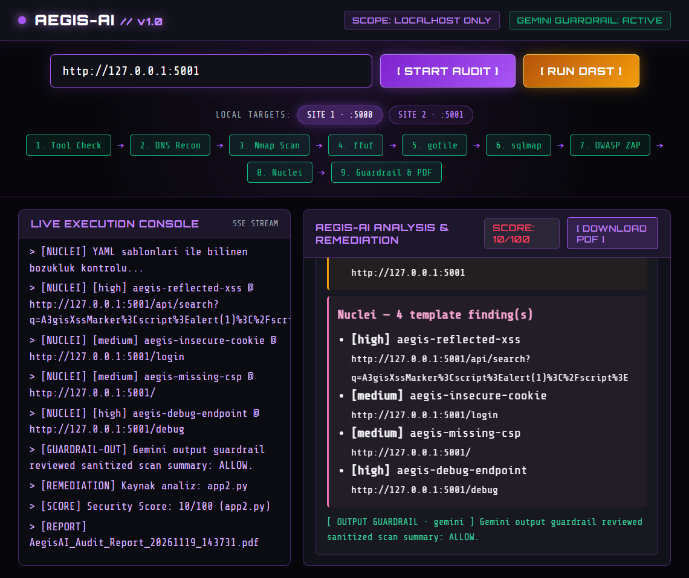
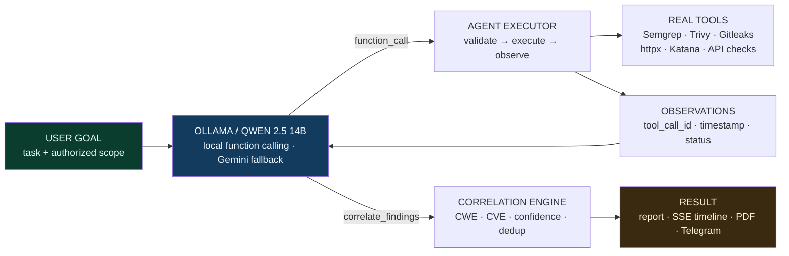
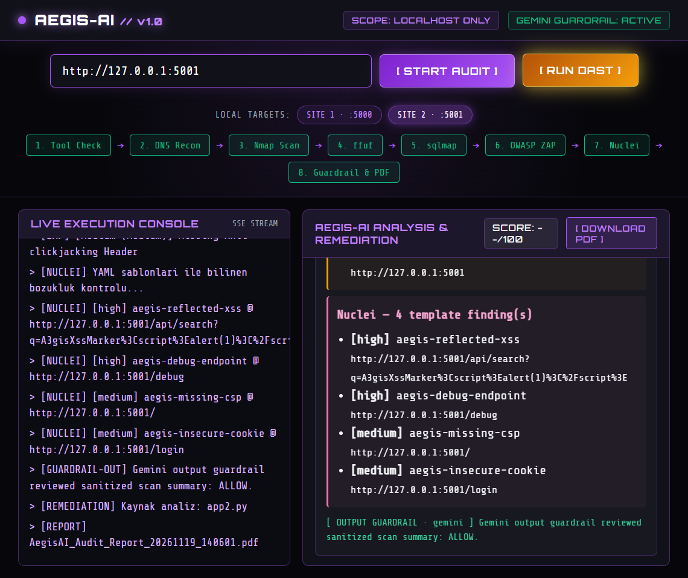
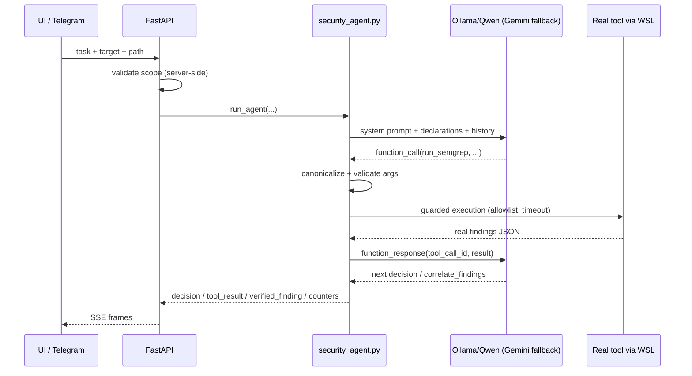
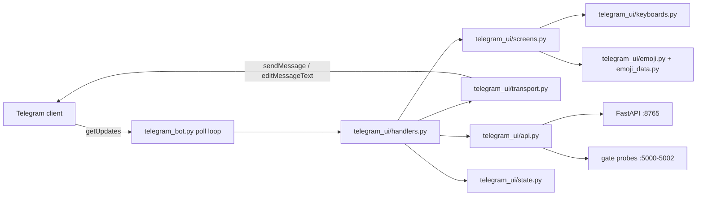
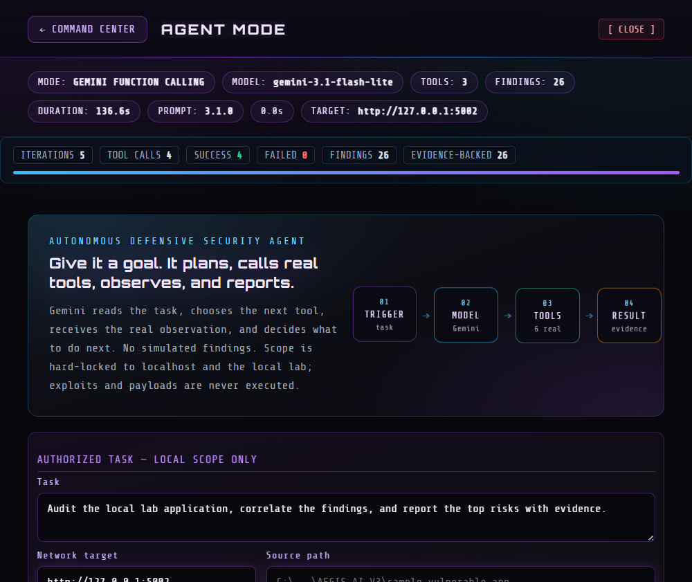

# AEGIS AI V3.1 — Autonomous Security Intelligence Platform

> **Author:** [wertybin](https://github.com/wertybin) — solo project.
> **Repository:** https://github.com/wertybin/aegis-ai-3.1
> **Support:** Telegram [@wertybin](https://t.me/wertybin) for all questions.

---

## 1. Project Name

**AEGIS AI V3.1** — an autonomous, evidence-driven defensive security assessment agent powered by local Ollama/Qwen function calling (free-tier Gemini is retained as a fallback). It is not a chatbot: it selects real tools itself, executes them inside a localhost-only guardrail, observes the output, and reports only what the tools actually found.

## 2. Project Overview

AEGIS started as a local OWASP-oriented audit dashboard (V1), gained a 9-stage DAST pipeline and an 11-module deep engine (V3), and in V3.1 adds a genuine agent loop. The user gives a goal in plain language; the configured model (Qwen 14b locally, Gemini as fallback) decides which scanners to call, receives their real JSON observations, decides the next step, and finishes with a verified report. The original UI, routes and V1 event contract are preserved unchanged.



## 3. Problem Statement

Developers and students need a fast, defensible first-pass security check of their own code and local APIs. Running Semgrep, Trivy, Gitleaks, httpx, Katana and API checks by hand means memorising commands, copying JSON between terminals, deduplicating overlapping findings, and writing the report yourself. Most people abandon the loop after the first tool. Static checklists cannot adapt to what a scanner actually discovered.

## 4. Who Benefits From AEGIS AI?

- Solo developers and students who need an evidence-backed audit before a commit or demo.
- Small teams without a dedicated AppSec engineer.
- Security Course participants who must show a *real* agent, not a scripted pipeline.
- Anyone who needs a safe local lab where exploitation, payloads and credential attacks are impossible by design.

## 5. Why Traditional Scanners Are Not Enough

| Traditional scanner | AEGIS V3.1 |
|---|---|
| Fixed command order | Model chooses the next tool from live evidence |
| Raw JSON dumped to the user | Observations are compressed into evidence and correlated |
| No memory across tools | Full function-call history is maintained and reused |
| A missing binary breaks the run | Honest install guidance; the agent continues with remaining tools |
| Reports can overcount duplicates | Totals are recomputed from raw tool output, with canonical dedup |

## 6. AEGIS AI Solution



## 7. Main Features

- **Real model function calling** — local Ollama/Qwen by default (the official `google-genai` SDK is an optional fallback), 11 function declarations, genuine `function_call` / `function_response` objects.
- **Adaptive decisions** — the model explains why it selects a tool and stops when evidence is sufficient.
- **11 real tools** — source, network, TLS, validation and correlation; no mocked scanner is ever reported as real.
- **Live Activity Center** — SSE events: `stage`, `log`, `decision`, `tool`, `tool_result`, `verified_finding`, `counters`, `error`, `final`, `complete`.
- **Cross-tool correlation** — canonical IDs, CWE/CVE, endpoint/parameter/method, numeric confidence, confirmed vs potential.
- **BEFORE/AFTER comparison** — numeric scan comparison plus optional Playwright screenshots and a visual slider.
- **Approval-gated remediation** — immutable backups, apply and rollback; nothing changes without explicit approval.
- **Premium Telegram bot** — Telegram-native screens, inline navigation, verified Premium custom emoji with honest Unicode fallback, and a real cooperative `/stop`; `/start`, `/help`, `/scan`, `/status`, `/pipeline`, `/report`, `/gates`, `/tools`, `/profile` and `/owner` are preserved.
- **Desktop launcher** — pywebview window or `AEGIS AI 3.1` desktop shortcut.
- **Backward compatible** — V1 routes and event names are untouched.

### Premium Telegram experience

The bot is a Telegram-only product: no Mini App, no webview, no browser. Every screen is a native Telegram message with HTML typography and a validated inline keyboard.

| Screen | What it shows | Real source |
|---|---|---|
| Welcome | Brand, scope, main menu | Static brand + chat identity |
| Command center | Backend latency, agent state, last run, fleet size | `/api/version`, `/api/agent/last`, cached `/api/tools` |
| Gates | Live status of `:5000`, `:5001`, `:5002` | Direct HTTP probes from the bot |
| Tools | 11-tool fleet, pagination, detail, live re-check | `/api/tools`, `/api/tools/{name}/check` |
| Profile | Chat, access, cooldown, last scan | Real chat + `telegram_ui.state` |
| Owner | Read-only deployment status, emoji provenance | `/api/version`, live state; no token or secret |
| Scan | Confirm → running → result/cancelled | `/api/agent/run`, `/api/agent/cancel` |

- **Main menu** — Gates · Tools · Profile · Owner · Help.
- **Navigation** — every Back button targets a deterministic parent (`gate → gates`, `tool → tools`, `profile → home`), so there is no fragile history stack.
- **Callbacks** — `ag:v1:<action>[:args]`, validated against a whitelist, capped at 64 bytes, acknowledged immediately, debounced against double taps, and protected by per-chat screen tokens so a slow worker cannot overwrite a newer screen.
- **`/stop`** — calls the new `POST /api/agent/cancel`, which sets a cooperative event checked between model turns and every 500 ms inside guarded WSL tools. A cancelled run returns `cancelled=true` and is **not** written to `agent_last.json`.
- **One real run at a time** — the backend rejects a second run with HTTP 409, and the bot mirrors that rule in per-chat state. A second chat sees a “scan busy” screen instead of briefly claiming a slot, so its `/stop` cannot cancel the first chat's scan. Only a configured owner may cancel a foreign run.
- **Transport resilience** — bounded retries for `429`, transient TCP resets and timeouts; custom-emoji rejection downgrades once to Unicode; HTML parse failure retries as plain text; “message not modified” is treated as success.
- **Emoji** — **61 verified custom emoji IDs** from the public **NewsEmoji** pack (100 animated TGS icons), harvested with `getStickerSet` and re-verified with `getCustomEmojiStickers`; 15 keys use Unicode fallbacks where the pack has no suitable icon. `TELEGRAM_EMOJI_MODE=auto` attempts the Premium icon once and permanently downgrades to Unicode if Telegram rejects it.
- **Telegram menu** — Gates and Tools share a green row. Profile and Owner each have a blue row when available.



## 8. Technology Stack

Python 3.10+ (tested on 3.14) · FastAPI 0.115 · Uvicorn · Pydantic 2 · Ollama + Qwen 2.5 14B (primary) · `google-genai` 3.x (optional Gemini fallback) · pywebview 5.3 (WebView2) · ReportLab · Pillow · optional Playwright/Chromium · WSL2 scanner binaries (Semgrep, Trivy, Gitleaks, httpx, Katana, testssl.sh) · server-sent events · file-based JSON/JSONL/PDF persistence.

## 9. Agent Architecture



The loop is capped at **8 model iterations / 8 tool calls**, with per-tool timeouts, transient `503/429/500` retries and an optional Gemini fallback chain. Every function call carries a unique `decision_id`, `tool_call_id`, timestamp, status, real output and error detail.

### Telegram UI architecture



The UI package never imports the bot entry point and never reads the token. The entry point injects `tg`, `api_get`, `api_post`, `allowed` and `parse_scan`; this keeps the existing transport tests valid and makes every screen mockable.



## 10. Trigger → Model → Tools → Result

| Stage | Implementation |
|---|---|
| **Trigger** | `[ RUN AGENT ]` in `#/agent`, `POST /api/agent/run`, `GET /api/agent-stream`, or Telegram `/scan` |
| **Model** | Local `qwen2.5:14b` via Ollama; optional fallback `gemini-3.1-flash-lite` → `gemini-3.5-flash-lite`, `gemini-2.5-flash-lite`, `gemini-3.5-flash`; deterministic fallback if neither is available |
| **Tools** | Registered in `backend/tool_registry.py`, executed by `backend/deep_scanner.py` under `backend/wsl_scanner.py` guardrails |
| **Result** | SSE timeline + tool cards + verified report + `reports/agent_last.json` + optional PDF + Telegram reply |

## 11. Model Function Calling Workflow

1. User goal, validated target and live tool status are sent as the first user message.
2. The model returns text reasoning and/or one or more `function_call`s.
3. `run_*` names are canonicalised (`run_semgrep → semgrep`) and arguments revalidated.
4. Exactly one allowlisted tool executes per call; scope is checked again after canonicalisation.
5. The compact real result is returned as a `function_response` with the matching call ID.
6. Steps 2–5 repeat until the model finishes or a limit is hit.
7. `correlate_findings` unifies evidence; final totals are recomputed from raw output, and the verified footer is appended to the model's report.

## 12. Tool Registry

Every tool declares a description, JSON parameter schema, permission level, output schema, timeout and install guide. Declarations sent to the model are generated from these contracts — it never receives a blank schema.

| Model function | Tool | Permission | Real behaviour |
|---|---|---|---|
| `run_semgrep` | Semgrep | `read-local-source` | SAST on the authorized source tree |
| `run_trivy` | Trivy | `read-local-source` | Dependency/misconfiguration CVEs |
| `run_gitleaks` | Gitleaks | `read-local-source-masked` | Secrets; values masked before the model sees them |
| `run_httpx` | httpx | `probe-localhost` | Status, title, technology fingerprint |
| `run_katana` | Katana | `crawl-localhost` | Endpoint discovery on the local URL |
| `run_api_security` | API checks | `probe-localhost` | REST/GraphQL control heuristics |
| `run_testssl` | testssl.sh | `probe-localhost-tls` | TLS/certificate analysis, https localhost only |
| `run_burp` | Burp Suite | `validate-only` | Version/availability only |
| `run_metasploit` | Metasploit | `validate-only` | Version + read-only module inventory; **no exploits** |
| `list_tools` | Registry | `read-status` | Live availability and versions |
| `correlate_findings` | Correlation | `read-results` | Dedup and confidence scoring |

## 13. System Prompt

Version-controlled at `prompts/security_agent.v3.1.md` and loaded by `backend/security_agent.py::load_system_prompt()` with `PROMPT_VERSION = 3.1.0`. Exact body:

```text
You are AEGIS AI, an autonomous security assessment and defensive analysis agent. You are AEGIS Agent, an autonomous defensive security auditor running on a Windows host with WSL2.

MISSION
Given a task, plan and execute a safe local security audit, then produce an evidence-based report.

AUTHORIZED SCOPE
- Network targets: only http(s)://localhost or http(s)://127.0.0.1.
- Source trees: only the local lab path supplied for this run (sample_vulnerable_app).
- Anything else is forbidden. If a tool reports SCOPE BLOCKED, do not retry that target.

HARD SAFETY RULES
- Never exploit a vulnerability, never send attack payloads, never brute-force credentials,
  never run destructive or denial-of-service tests.
- Use only the tools provided in this session.
- Never invent a finding. Every claim must be backed by a tool observation.
- Never reveal secret values; the tool layer masks them.
- If a tool is missing, report that honestly and continue with the remaining tools.

DECISION TRANSPARENCY
- Before each tool call, state in one sentence why that tool is relevant to the current evidence.
- After each observation, state what is confirmed, what is only potential, and what evidence is still missing.
- Never describe an AI hypothesis as a confirmed vulnerability.
- Explain a skipped web tool when no HTTP service was discovered.

INTERPRETING RESULTS
- Prefer accuracy over a high finding count. Combine repeated evidence from multiple tools.
- If a tool is unavailable or reports no findings, say so; never compensate by inventing results.
- Treat a single-source observation as potential until a second source or direct evidence confirms it.

WHEN TO STOP
- Stop once the authorized scope is covered and the top risks have direct tool evidence.
- Stop immediately on SCOPE BLOCKED, on repeated tool failure, or at the 8-call limit.
- Do not repeat a tool with identical arguments.

WORKFLOW
1. Optionally call list_tools to confirm live availability.
2. If a source path is in scope, call run_semgrep, run_trivy and run_gitleaks.
3. If a URL is in scope, call run_httpx, run_katana and run_api_security.
   Use run_testssl only for https:// targets. run_burp and run_metasploit are safe
   validation-only fallbacks; they never execute exploits.
4. Call correlate_findings once.
5. Finish with a concise report: severity counts, the top five findings with locations,
   a confirmed/potential classification, and the single most important next action.

Call at least TWO real scanning tools before finishing whenever both source and URL are
available. Do not call the same tool twice with the same arguments. Maximum 8 tool calls.
```

## 14. Security Guardrails

- **Scope:** your own `localhost` / `127.0.0.1` targets only; source paths are the local ones you configure in `.env` inside this project. No target URL is bundled.
- **Execution:** command allowlist, no shell concatenation from model output, hard timeouts, cooperative cancellation, output truncation.
- **Network:** SSRF, DNS rebinding, redirect abuse and external hosts rejected before execution.
- **API:** explicit CORS origins, Host/Origin middleware for `/api`, localhost-only binding, secrets only from `.env`.
- **Safety:** no exploit execution, no payloads, no credential extraction, no destructive tests.
- **Remediation:** explicit approval, immutable backup, rollback, and an append-only ledger.

## 15. Before & After Comparison

`backend/comparison.py` compares two real persisted scans (score, severity, endpoints, correlations, CVSS, attack surface, graph, resolved/new/persisting findings). V3.1 adds `backend/visual_diff.py`: optional Playwright screenshots with metadata (snapshot ID, scan ID, timestamp, target, viewport) and Pillow pixel diff exposed through a visual slider. **A screenshot change never marks a finding resolved** — only a verification scan can do that. If Playwright is absent, the UI honestly reports the install command instead of showing a fake image.

## 16. Cross-Tool Correlation

`backend/deep_correlation.py` normalises every finding to a canonical schema: `canonical_id`, title, CWE, CVE, endpoint, parameter, HTTP method, severity, CVSS where available, source tools, evidence, numerical confidence, verification status and remediation. Only the same weakness at the same location is merged; unrelated findings stay separate. Multi-tool evidence yields `finding_class: confirmed`; single-source observations stay `potential`. AI explanations are attached to already-established groups and can never invent or downgrade a finding.

## 17. Installation Instructions

```powershell
git clone https://github.com/wertybin/aegis-ai-3.1.git
cd aegis-ai-3.1
python -m venv .venv
.\.venv\Scripts\Activate.ps1
pip install -r requirements.txt
# optional visual capture:
pip install -r requirements-visual.txt
python -m playwright install chromium
# tests:
pip install -r requirements-dev.txt
```

## 18. Environment Configuration

Copy `.env.example` to `.env`. Never commit `.env`.

| Variable | Purpose |
|---|---|
| `AEGIS_MODEL_PROVIDER` | Primary provider, default `ollama`; set `gemini` to use the optional fallback directly |
| `AEGIS_OLLAMA_URL` | Your local Ollama endpoint; no default is bundled |
| `AEGIS_OLLAMA_MODEL` | Local model, default `qwen2.5:14b` |
| `AEGIS_OLLAMA_EXECUTABLE` | Portable Ollama binary, default `runtime\ollama\ollama.exe` |
| `AEGIS_OLLAMA_CONTEXT` / `AEGIS_OLLAMA_TIMEOUT` | Context window and model HTTP timeout |
| `GEMINI_API_KEY` | Optional free AI Studio key for the Gemini fallback |
| `AEGIS_GEMINI_MODEL` | Fallback model, default `gemini-3.1-flash-lite` |
| `AEGIS_GEMINI_FALLBACK_MODELS` | Comma-separated free fallback chain |
| `AEGIS_BROWSER_ENABLED` | `1` enables the visible browser tool |
| `AEGIS_DEFAULT_TARGET` | Your default localhost scan target; no address is bundled |
| `AEGIS_GATE_1_URL` / `AEGIS_GATE_2_URL` / `AEGIS_GATE_3_URL` | Your own localhost URLs shown as Gates in the bot and UI |
| `AEGIS_GATE_1_SOURCE` / `AEGIS_GATE_2_SOURCE` / `AEGIS_GATE_3_SOURCE` | Local source paths used by the quick audit for each gate |
| `AEGIS_API_BASE` | Your AEGIS API URL for the Telegram bot; no default is bundled |
| `TELEGRAM_BOT_TOKEN` | From @BotFather; enables the Telegram bot |
| `TELEGRAM_ALLOWED_CHAT_IDS` | Empty = public bot; comma list restricts chats |
| `TELEGRAM_OWNER_CHAT_IDS` | Optional owner console allow-list; empty = read-only console for already-authorized chats |
| `TELEGRAM_EMOJI_MODE` | `auto` (try verified Premium emoji, fall back), `custom`, or `unicode` |
| `AEGIS_SERIAL_PORT` | Optional ESP32 status beacon |

## 19. How to Run

```powershell
.\start_all.ps1                       # UI + your configured local lab sites
# open the AEGIS UI URL you set in AEGIS_API_BASE, then /#/agent
.\start_telegram_bot.ps1              # optional Telegram bot
.\install_desktop.ps1                 # optional AEGIS AI 3.1 desktop shortcut
```

Agent page: type a task, enter your own localhost URL (or set `AEGIS_DEFAULT_TARGET` in `.env`), press `[ RUN AGENT ]`. No target address is bundled with the release.

Telegram commands: `/start` · `/menu` · `/help` · `/scan [target] [task]` · `/stop` · `/status` · `/pipeline` · `/report` · `/gates` · `/tools` · `/profile` · `/owner`. `/scan` starts immediately (60 s per-chat cooldown); `/pipeline` runs DAST → Audit → Agent with live SSE progress; `/stop` cancels the active run cooperatively.

## 20. Demo Scenario

The 120-second recording script is in `docs/DEMO_SCRIPT.md`. Reproducible driver:

```powershell
.\.venv\Scripts\python.exe demo\run_demo.py --no-open
```

Timeline: 0:00 problem · 0:15 authorized target · 0:30 the model selects ≥2 real tools · 0:50 real findings and correlation · 1:20 attack graph and BEFORE/AFTER · 1:40 remediation and final report. Final verified real run (2026-11-24): **`ollama-function-calling`, `qwen2.5:14b`, 6 tool calls (browser → httpx → Katana → api_security → Semgrep), 27 real findings**. Earlier Gemini run (2026-11-22): `gemini-function-calling`, `gemini-3.1-flash-lite`, 4 calls (Semgrep → httpx → Katana → correlate_findings), 21 unique findings in ~262 s. Tool choice is adaptive, so numbers vary; quote what is on screen. Model and Semgrep latency can exceed 2 minutes, so the recording must be edited/compressed to ≤2:00 — never fake results.

## 21. Testing Instructions

```powershell
.\.venv\Scripts\python.exe -m pytest -q tests
```

Mock unit tests cover prompt/version, tool contracts, canonicalisation, iteration limits, guardrails/scope, dedup and confidence, API compatibility, visual-diff honesty, PDF generation, Telegram transport, the verified emoji registry, callback validation, every keyboard, every screen, `/stop` cancellation and handler routing. They are labelled MOCK and never claim real scanner execution. The full verification record — including real-vs-mock distinctions, tool availability and known limitations — is in `DEVELOPMENT_REPORT.md`. Real integration checks:

```powershell
.\.venv\Scripts\python.exe demo\run_demo.py --no-open
```

The Telegram-specific suite is `tests/test_telegram_ui.py` (54 tests): registry provenance, custom-emoji/HTML/429/network fallbacks, callback forgery rejection, callback-length limits, keyboard validity, HTML escaping, pagination, state/cooldown, global single-run locking, `/start`, `/scan`, `/stop`, `/report`, `/pipeline`, DAST/Audit/Agent stage ordering, real SSE progress rendering, pipeline cancellation, cooldown, callback navigation, duplicate taps, tool re-check, owner permissions, token redaction and credential-safe scan logging. Final in-repo result: **99 passed** (the extra tests cover the Ollama/Qwen history, browser scope/fallback routing and Telegram PDF delivery).

The same **99/99** suite passes locally. `START_ALL.cmd` / `start_all.ps1` start the UI, your configured local targets, the DNS lab, Ollama and the long-polling Telegram bot as detached processes. Live `/api/tools` returned **11/11 installed in 7.07 s**, and a real cancellation finished in **3.08 s** without changing the last-run timestamp. All **31** premium screens were also rendered from the live `/api/agent/last` and `/api/tools` payloads: every message stayed under 4096 characters, every HTML tag balanced, and every keyboard validated.

Telegram `/pipeline` opens a real DAST → Audit → Agent control panel. Each gate has four callbacks: `DAST`, `Audit`, `Agent` and `Full chain`. DAST/Audit use `POST /api/engine/start`, progress comes from decoded `GET /api/engine/stream/{scan_id}` SSE stage events, and `POST /api/engine/scans/{scan_id}/cancel` stops only the chat's own active scan. The Agent stage reuses the existing `/api/agent/run` path. A live callback test started a real DAST scan (`scan_20261124_204958_2a67c2`), streamed real Nmap/FFUF events and cancelled it at `20:50:20`; a separate live `paudit` callback completed `scan_20261124_205047_d911af` with score 10 and a real PDF.

## 22. Limitations

- Only localhost and explicitly configured local lab paths are in scope; remote targets are intentionally rejected.
- The local Ollama model can be slow on limited hardware; the optional Gemini fallback can return HTTP 503 under load, and retries reduce but do not eliminate this.
- Playwright/Chromium is optional and not bundled; visual capture reports unavailable when missing.
- Attack-graph paths and AI explanations are labelled potential unless backed by tool evidence.
- Persistence is file-based JSON/JSONL/PDF, not a multi-user database.
- Desktop window requires Windows WebView2 (present on Windows 10/11).
- **Telegram custom emoji are capability-gated by Telegram**: a bot can send them only if it owns a Fragment-purchased username or its owner has Telegram Premium, and only in supported chat types. The bot attempts the verified IDs once, then permanently downgrades to Unicode and retries; the layout is identical either way.
- **Button colours** use Telegram’s native `success` (green), `primary` (blue) and `danger` (red) styles. Telegram chooses the exact shade. See [InlineKeyboardButton](https://core.telegram.org/bots/api#inlinekeyboardbutton).
- **No Mini App** by design; everything is a native Telegram message.
- `/stop` is cooperative, not a hard process kill: it aborts between model turns and every 500 ms inside guarded WSL tools. A cancelled run is not stored as the last result.
- Live chat transport was verified by driving the real handler stack against a live chat through the Bot API: `/start`, the Gates callback, `/scan`, `/stop`, `/status`, `/report` and `/pipeline` all worked; the cancellation returned `cancelled=true`, the PDF was delivered with `sendDocument`, and the pipeline callback started/cancelled a real engine scan. Custom-emoji IDs were verified through `getStickerSet` + `getCustomEmojiStickers` (400/400 IDs), but a Premium client render cannot be forced from the server; the automatic Unicode downgrade remains the supported fallback.

## 23. Where I Got Stuck

Seven real problems cost an evening and are now handled in code.

1. **Model 503 on the free tier.** An early live run died with HTTP 503 from the fallback model mid-audit. I added bounded retries for transient `503/429/500` and an explicit chain of other free models. When neither provider is available, the app degrades to `deterministic-fallback` and says so instead of pretending to reason.
2. **Tool-name mismatch.** The model emitted `run_semgrep` while the executor expected `semgrep`, so every call failed with "Unknown tool". I added a canonicalisation layer plus post-mapping scope revalidation. The same run then completed with six real tools and 33 findings.
3. **Metasploit installed on a different path.** The registry hardcoded `~/metasploit-framework/msfconsole`, but the Rapid7 apt installer puts `msfconsole` on `PATH` (`/usr/bin/msfconsole`), so the tool still reported MISSING after installation. I switched detection to `command -v msfconsole` with the old clone path as fallback, replaced the retired `search type:scanner` query with portable `search scanner`, and fixed the module-row parser (msfconsole prefixes rows with a numeric index). `/api/tools` now reports 11 OK / 0 MISSING at final audit with real version probes (`Framework Version: 6.5.12-dev-`, Burp Suite Community `2026.3.3-47134`).
4. **Telegram bot never polled.** The token and `@BotFather` setup were valid, but `tg()` passed the `urllib.request` **module** into a helper that calls `opener.open()` — a module only has `urlopen()`. Every `getUpdates`/`sendMessage` call therefore died with `AttributeError: module 'urllib.request' has no attribute 'open'`, while the poll loop just kept logging retries. I introduced a real `build_opener()` instance and added two mock-only regression tests (`tests/test_telegram.py`). The bot now starts with a clean log and `getUpdates` returns `ok=true`.
5. **Custom emoji could not be guessed.** The Bot API has no "search all emoji" method, and a made-up ID is a lie that fails at send time. I fetched public sticker-set metadata with `getStickerSet`, harvested 400 IDs from four packs, re-checked every ID with `getCustomEmojiStickers` (400/400 verified), then kept one consistent animated pack (**NewsEmoji**, 61 IDs) and generated an ASCII-safe registry. If Telegram rejects a custom emoji, the transport retries with Unicode. Button labels use Unicode glyphs.
6. **A callback UI without dead buttons.** The old bot had no callback architecture at all. I added a versioned `ag:v1:<action>[:args]` codec with a whitelist, 64-byte enforcement, gate/tool argument validation, immediate acknowledgements, double-tap debounce and per-chat screen tokens so a slow `/api/tools` worker cannot overwrite a newer screen. Back navigation is parent-based (`gate → gates`, `tool → tools`), not a history stack that breaks when a message is edited.
7. **`/stop` had nothing to stop.** There was no cancellation endpoint. I added `POST /api/agent/cancel` and bound a `threading.Event` to the agent's execution context. The event is checked between model turns and every 500 ms inside the guarded WSL runner, which terminates the child process. The sync API returns `cancelled=true` in **4.07 s** on a real run and deliberately does not write the cancelled result to `agent_last.json`; the SSE path emits a final `error` with `cancelled=true`. The bot exposes this as `/stop` and a Stop button.

A smaller one: WSL `testssl.sh` wrote JSON with absolute Windows paths into the repo root. I made WSL scripts script-relative through `AEGIS_ROOT` and excluded transient artefacts in `.gitignore`.

## 24. Future Improvements

### Local model and visible browser (Ollama)

Run `SETUP_OLLAMA.cmd` from the repository root once to start the portable Ollama
runtime and download Qwen 2.5 14B. Then use `START_ALL.cmd` for normal startup.
The Ollama executable is under `runtime/ollama`, models under
`runtime/ollama-models`, installer archives under `runtime/downloads`, browser
files under `.playwright`, and logs under `logs`. Runtime and browser binaries
are gitignored; they are local dependencies, not source files.

Set `AEGIS_MODEL_PROVIDER=ollama`, `AEGIS_OLLAMA_MODEL=qwen2.5:14b`,
`AEGIS_OLLAMA_URL=<your-local-Ollama-URL>` and `AEGIS_BROWSER_ENABLED=1` in `.env`.
Keep `GEMINI_API_KEY` for automatic fallback. Install Ollama, run
`ollama pull qwen2.5:14b`, and install `requirements-visual.txt` plus Chromium.
The project uses a local `.playwright` directory configured through
`PLAYWRIGHT_BROWSERS_PATH`. The model is about 9 GB; 8 GB VRAM needs partial
CPU/RAM offload, so latency must be measured rather than assumed.

In Agent Mode, ask: `Inspect the local site in the visible browser, navigate
its pages, fill a benign test form, and audit it with at least two scanners.`
Qwen 2.5 is text-only: it decides from page text and DOM elements, not pixels.
The browser tool opens Chromium visibly, exposes individual inspect/open/click/fill
actions, blocks other origins and downloads, and stores masked screenshots in
`reports/browser/`. Final web reports show the browser observations and screenshots.
Browser observations are not automatically counted as confirmed vulnerabilities.
At the existing 8-call budget, prioritize a few browser steps plus two scanners.
The UI identifies Ollama function calling separately from Gemini and deterministic
fallback. `/stop` is checked between model turns; a blocking model HTTP call can
last up to `AEGIS_OLLAMA_TIMEOUT` seconds (default 180).

- Optional authenticated remote-lab mode with signed, time-bounded scope tokens.
- SQLite/Postgres audit history for multi-user teams and relational evidence queries.
- Scheduled drift monitoring with diff alerts and historical attack-graph comparison.
- Additional free providers (NVIDIA / OpenRouter `:free`) in the model chain.
- A dedicated Fragment-purchased bot username so verified custom emoji render for every user, not only where Telegram allows it.
- Signed PDF reports and exportable evidence bundles for external audits.
